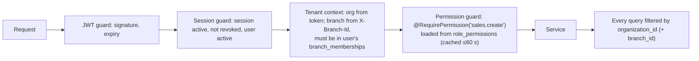

# Authentication and Authorization

Phase 1 · draft.

## Tokens

- **Access token**: JWT, 15 min, claims `sub`, `sid` (session id), `org`, `v` (token version). No permissions embedded.
- **Refresh token**: random 256-bit opaque string, stored **hashed** (SHA-256) in `user_sessions`, bound to a device, rotated on every use. Reuse of an already-rotated token revokes the whole session (theft detection). Lifetime 30 days sliding **[ASSUMPTION]**.
- Passwords: Argon2id. Login throttled per IP and per account.
- Mobile stores tokens in SecureStore only.

## Login and refresh

```mermaid
sequenceDiagram
  participant App
  participant API
  participant DB
  App->>API: POST /auth/login {phone/email, password, device info}
  API->>DB: verify user, org membership, active
  API->>DB: create session + device (refresh hash)
  API-->>App: access JWT + refresh token
  Note over App: later, access expired
  App->>API: POST /auth/refresh {refresh}
  API->>DB: find session by hash; if rotated-reuse → revoke session
  API->>DB: rotate refresh hash
  API-->>App: new pair
```

## Request authorization pipeline



- Session and permission checks hit the DB/cache each request, so deactivation and role changes take effect within ~60 s (immediately on session revocation).
- Tenant scoping is applied in repositories via a required `TenantContext` parameter; cross-org tests are mandatory in Phase 5.
- Sensitive actions (discount above limit, negative-stock override, cancellation, price change) require specific permissions and write audit rows.

## Roles (seeded per organization, editable)

Owner (all, non-removable), Manager, Cashier, Collection Agent. Permissions are fine-grained strings (`product.read`, `sale.create`, `sale.cancel`, `discount.override`, `stock.adjust`, `ledger.read`, …); full list defined in Phase 5.

## Invitations

Owner/Manager creates an invitation (role + branches) → one-time code or link, expires in 72 h → invitee sets password → membership created.

---

## As built in Phase 5 (2026-11-18)

Where this section differs from the design above, **this section is correct**.

### Endpoints

| Route                                                                                       | Access                                    | Notes                                                                                                                                                                                                                                     |
| ------------------------------------------------------------------------------------------- | ----------------------------------------- | ----------------------------------------------------------------------------------------------------------------------------------------------------------------------------------------------------------------------------------------- |
| `POST /auth/register-owner`                                                                 | public, rate limited                      | One transaction creates the organization, 4 system roles with permissions, the owner user, the first branch (`MAIN`) with its cash register and 5 number series, default expense categories, device and session. Returns tokens + profile |
| `POST /auth/login`                                                                          | public, rate limited                      | Mobile number or email. Same 401 for wrong password and unknown user. `409 ORGANIZATION_REQUIRED` (with the list) when one login belongs to several shops                                                                                 |
| `POST /auth/refresh`                                                                        | public, rate limited                      | Rotates the refresh token on every use                                                                                                                                                                                                    |
| `POST /auth/accept-invitation`                                                              | public, rate limited                      | Code `XXXX-XXXX-XXXX` (case and dash tolerant). Existing accounts must supply their current password                                                                                                                                      |
| `POST /auth/logout`, `GET /auth/me`, `POST /auth/change-password`, `PATCH /devices/current` | any signed-in member                      |                                                                                                                                                                                                                                           |
| `GET/PATCH /organization`, `GET/POST/PATCH /branches`                                       | `organization.*`, `branch.*`              |                                                                                                                                                                                                                                           |
| `GET/PATCH /employees[/:id]`, `POST /employees/:id/deactivate` and `/reactivate`            | `employee.*`                              |                                                                                                                                                                                                                                           |
| `GET /devices`, `POST /devices/:id/revoke`, `/restore`, `/release`                          | `employee.read` (list), `employee.manage` | A blocked phone cannot sign in (`403 DEVICE_REVOKED`); a phone belongs to one user (`403 DEVICE_OWNED_BY_OTHER`) until released. All three changes are audited (TD-135)                                                                   |
| `GET/POST/PATCH/DELETE /roles`, `GET /permissions`                                          | `role.*`                                  |                                                                                                                                                                                                                                           |
| `POST/GET /invitations`, `POST /invitations/:id/revoke`                                     | `invitation.manage`                       |                                                                                                                                                                                                                                           |

### Security rules implemented

- **Passwords**: Argon2id (`@node-rs/argon2`, 19 MiB / 2 passes / 1 lane). Login always performs a hash verification (a dummy hash for unknown users) to equalise timing.
- **Access token**: JWT HS256, 15 minutes, issuer, audience and algorithm pinned. **Every request** also checks the session row (not revoked, not expired, user active, `tokenVersion` matches), so logout, deactivation and password change act immediately.
- **Refresh token**: 32 random bytes, stored only as SHA-256, 30-day sliding expiry capped by an **absolute lifetime of 90 days from sign-in** (`SESSION_ABSOLUTE_TTL_DAYS`; checked on refresh and on every request, revoked with reason `absolute_expiry`), rotated on each use with an atomic conditional update. Presenting an already-rotated token **revokes the whole session** (theft detection). Trade-off: a legitimate client that retries a refresh after a lost response is also signed out and must log in again.
- **Authorization pipeline** (global guards, in order): rate limit, authentication, tenant context, permission. **Default deny**: an authenticated route with no `@RequirePermission(...)` or `@AuthenticatedOnly()` is refused.
- **Owner** is the system role named `Owner`; it is treated as holding every permission (including future ones). It cannot be edited, assigned to others, deactivated or deleted. A custom role that is merely named "Owner" gets no special treatment.
- **No privilege escalation**: you can only create, edit, assign or invite with roles whose permissions you hold yourself.
- **Tenant isolation**: the organization comes only from the token. Every lookup of employees, roles, invitations and branches is scoped by organization; another shop's ids behave as "not found" (404, never 403), so their existence is not revealed.
- **Credential endpoints** have a stricter per-IP limit (`AUTH_THROTTLE_LIMIT`, default 10 per minute) on top of the global limit.
- **Invitation codes**: 12 characters from an unambiguous alphabet (about 59 bits), 72 hour expiry, shown once, stored hashed, and claimed atomically so two simultaneous acceptances cannot both win.
- **Audit**: registration, role create/update/delete, employee update/deactivate/reactivate, invitation create/revoke/accept, password change, and organization and branch changes are written to the append-only `audit_logs` in the same transaction as the change.

### Known limitations (tracked for later phases)

1. **No "forgot password" flow.** It needs an SMS or email provider, which has not been chosen. Workaround today: the owner can deactivate and re-invite an employee. An owner who forgets their password has no recovery path. **Owner decision needed.**
2. Invitation codes are shared manually (for example over WhatsApp); the API does not send SMS or email.
3. Rate limiting is per IP only; there is no per-account lockout counter (can be added in the Phase 16 audit).
4. The role-permission cache (30 seconds) is per API instance. With one Cloud Run instance changes are immediate; with several, other instances may lag up to 30 seconds (session revocation is always immediate).
5. One owner per shop; ownership transfer is not implemented.
