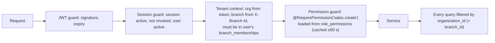

# Authentication and Authorization

Phase 1 · draft.

## Tokens

- **Access token**: JWT, 15 min, claims `sub`, `sid` (session id), `org`, `v` (token version). No permissions embedded.
- **Refresh token**: random 256-bit opaque string, stored **hashed** (SHA-256) in `user_sessions`, bound to a device, rotated on every use. Reuse of an already-rotated token revokes the whole session (theft detection). Lifetime 30 days sliding **[ASSUMPTION]**.
- Passwords: Argon2id. Login throttled per IP and per account.
- Mobile stores tokens in SecureStore only.

## Login and refresh

```mermaid
sequenceDiagram
  participant App
  participant API
  participant DB
  App->>API: POST /auth/login {phone/email, password, device info}
  API->>DB: verify user, org membership, active
  API->>DB: create session + device (refresh hash)
  API-->>App: access JWT + refresh token
  Note over App: later, access expired
  App->>API: POST /auth/refresh {refresh}
  API->>DB: find session by hash; if rotated-reuse → revoke session
  API->>DB: rotate refresh hash
  API-->>App: new pair
```

## Request authorization pipeline



- Session and permission checks hit the DB/cache each request, so deactivation and role changes take effect within ~60 s (immediately on session revocation).
- Tenant scoping is applied in repositories via a required `TenantContext` parameter; cross-org tests are mandatory in Phase 5.
- Sensitive actions (discount above limit, negative-stock override, cancellation, price change) require specific permissions and write audit rows.

## Roles (seeded per organization, editable)

Owner (all, non-removable), Manager, Cashier, Collection Agent. Permissions are fine-grained strings (`product.read`, `sale.create`, `sale.cancel`, `discount.override`, `stock.adjust`, `ledger.read`, …); full list defined in Phase 5.

## Invitations

Owner/Manager creates an invitation (role + branches) → one-time code or link, expires in 72 h → invitee sets password → membership created.
