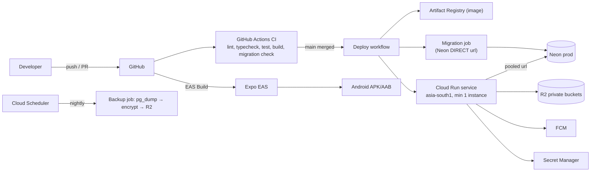

# Deployment Architecture

Phase 1 · draft.

## Environments

| Env        | API                                  | DB                  | Purpose                |
| ---------- | ------------------------------------ | ------------------- | ---------------------- |
| local      | `pnpm dev` on PC                     | Neon **dev** branch | Development            |
| staging    | Cloud Run service `ksms-api-staging` | Neon staging branch | Pre-release validation |
| production | Cloud Run service `ksms-api`         | Neon main           | Live shop              |

## Connection strategy (resolves risk R-07 on paper; proven by a test in Phase 4)

- Runtime uses Neon's **pooled** URL (PgBouncer, transaction mode). Interactive Prisma transactions, `SELECT … FOR UPDATE` and `pg_advisory_xact_lock` are safe because the connection is pinned for the transaction's duration.
- **Forbidden** on the pooled URL: session-level advisory locks, `LISTEN/NOTIFY`, session `SET`.
- Migrations and backups use the **direct** URL from a CI job, never at app startup.
- Phase 4 includes a concurrency test through the pooled URL; if it fails, checkout switches to the direct URL (ADR).

## Runtime settings (decided in Phase 17)

Min instances 1 (avoid cold start at the counter), concurrency ~40, graceful SIGTERM shutdown, `/api/v1/health` (liveness) and `/api/v1/health/ready` (DB check), secrets from Secret Manager, structured JSON logs to Cloud Logging.

## Backups

Neon point-in-time restore plus an independent nightly encrypted dump to R2 with retention (e.g., 30 daily / 12 monthly). Restore drill documented and rehearsed before release.
