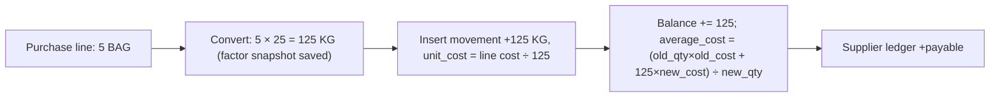

# Inventory Workflow

Phase 1 · draft.

## Model

- `inventory_balances(org, branch, product)` holds `quantity_on_hand`, `reserved_quantity`, `average_cost` in the product **base unit**. It is a derived cache of the movement log.
- `stock_movements` is append-only and signed. Types: OPENING, PURCHASE_RECEIPT, SALE, SALE_RETURN_SALEABLE, PURCHASE_RETURN, ADJUSTMENT_IN/OUT, DAMAGE, EXPIRY, CANCELLATION_REVERSAL, TRANSFER_IN/OUT (future).
- Invariant (tested nightly and in CI): `balance.on_hand = SUM(movements.quantity)` per product/branch.
- Non-saleable returns and damaged stock go to movement types that reduce or never add to `on_hand` (quarantine tracked via batch/status), so available stock stays correct.

## Receipt (purchase)

## Rules

- Weighted-average cost recomputed only on receipts; sales/returns record the cost at that time as `unit_cost_snapshot` for COGS/gross profit.
- FEFO: for products with `track_expiry`, sales consume batches by earliest expiry first; expired batches are not sellable (hard block, configurable warning window).
- Negative stock blocked by the conditional UPDATE; override requires permission and is audited with reason.
- Adjustments need a reason code and permission; they create movements, never edit balances.
- Concurrency: row-level locks / conditional updates inside the caller's transaction; tests with parallel checkouts on the final unit.
- Alerts: low-stock (`on_hand <= min_threshold`) and expiry-window queries; notifications emitted post-commit.

---

## As built in Phase 7 (2026-11-18)

Where this section differs from the design above, **this section is correct**. Code: `apps/api/src/modules/inventory/`.

### The engine is the only way stock changes

`InventoryService` exposes `receive()`, `issue()` and `issueMany()`. Opening stock and adjustments use it now; purchase receipts (Phase 8), sales, returns and cancellations (Phase 9) will call the same methods, so their stock behaviour is the one tested here. Every call:

1. runs inside the caller's database transaction (so a sale and its stock change commit or fail together);
2. creates the balance row if missing (`INSERT ... ON CONFLICT DO NOTHING`) and **locks it with `SELECT ... FOR UPDATE`** before reading;
3. for batch- or expiry-tracked products, locks the batch rows in FEFO order;
4. writes one signed, append-only `stock_movements` row per batch touched, with the cost and the balance after it;
5. updates the cached balance and the batch quantities.

Lock order is always balance, then batches; `issueMany()` processes products in id order. Together these make concurrent sales deadlock-free and impossible to oversell.

### Rules

| Rule            | Behaviour                                                                                                                                                                                                                                   |
| --------------- | ------------------------------------------------------------------------------------------------------------------------------------------------------------------------------------------------------------------------------------------- |
| Units           | Everything is stored in the product's base unit. API input may use any configured unit (5 BAG = 125 KG); costs are converted per base unit                                                                                                  |
| Available stock | `quantity_on_hand - reserved_qty` (reservations stay 0: held bills never reserve stock)                                                                                                                                                     |
| Negative stock  | Refused with `409 INSUFFICIENT_STOCK` (details: requested, available, expired). Allowed only when the shop setting is on **and** the user has `stock.override_negative` **and** gives a reason; audited as `stock.adjust.negative_override` |
| Costing         | Moving weighted average, recomputed on every inbound movement, rounded half-up to 4 decimals. Outbound movements record the average at that moment as their cost (cost of goods)                                                            |
| Deficit         | When stock is at or below zero, the next receipt's cost becomes the average (the old average no longer describes physical stock)                                                                                                            |
| Batches         | Products with `trackBatch` need a batch number; `trackExpiry` needs an expiry date (the batch number defaults to `EXP-<date>`). A batch number keeps one expiry date                                                                        |
| FEFO            | Sales take the earliest-expiring batch first; batches without expiry last; ties by date received                                                                                                                                            |
| Expired stock   | Never sold (stock expiring today is still sellable today, India time). Never received. Written off with an `EXPIRY` adjustment naming the batch; the batch status becomes `EXPIRED`                                                         |
| Opening stock   | Allowed only while the product has no other activity in the branch (`OPENING_STOCK_LOCKED` afterwards; use an adjustment)                                                                                                                   |
| Adjustments     | Signed quantity with a reason: DAMAGE, EXPIRY, LOSS (must remove), FOUND (must add), COUNT_CORRECTION, OTHER. Removing stock of a tracked product needs the batch. Found stock without a cost is valued at the current average              |
| Idempotency     | Opening stock and adjustments require an `Idempotency-Key` header; repeats return the stored result (`Idempotent-Replayed: true`), a different payload with the same key is refused                                                         |
| History         | Movements are append-only (database trigger). Balances are a cache that `GET /inventory/reconciliation` proves against the movements                                                                                                        |

### API (all require `X-Branch-Id`)

| Route                                | Permission         | Notes                                                          |
| ------------------------------------ | ------------------ | -------------------------------------------------------------- |
| `GET /inventory/balances`            | `stock.read`       | `q`, `categoryId`, `lowStock=true`, `inStock=true`, pagination |
| `GET /inventory/balances/:productId` | `stock.read`       | Balance, batches with expiry status, latest 20 movements       |
| `GET /inventory/movements`           | `stock.read`       | `productId`, `type`, `from`, `to`, pagination                  |
| `GET /inventory/expiring`            | `stock.read`       | Expired or expiring within `withinDays` (default 30)           |
| `GET /inventory/valuation`           | `report.inventory` | Total and per-category value at weighted-average cost          |
| `GET /inventory/reconciliation`      | `stock.adjust`     | Balances vs movements, batches vs movements                    |
| `POST /inventory/opening-stock`      | `stock.adjust`     | Idempotency-Key required                                       |
| `POST /inventory/adjustments`        | `stock.adjust`     | Idempotency-Key required                                       |

Cost and value fields appear only for roles with `report.inventory` (or the Owner); cashiers see quantities only.

### Not in this phase

- Low-stock and expiry **push notifications** (the queries exist; delivery is the notifications work in Phase 13/15).
- Stock transfers between branches (tables exist; future roadmap).
- Quarantine of non-saleable returns is part of the sales-return workflow (Phase 9).

### Update in Phase 8

Purchase receipts and purchase returns now use this engine (`PURCHASE_RECEIPT`, `PURCHASE_RETURN`). See `PROCUREMENT_WORKFLOW.md`. The engine also refuses impossible calendar dates for expiry (`2026-02-31`).
