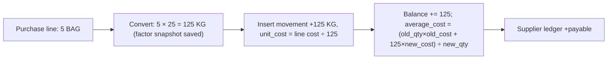

# Inventory Workflow

Phase 1 · draft.

## Model

- `inventory_balances(org, branch, product)` holds `quantity_on_hand`, `reserved_quantity`, `average_cost` in the product **base unit**. It is a derived cache of the movement log.
- `stock_movements` is append-only and signed. Types: OPENING, PURCHASE_RECEIPT, SALE, SALE_RETURN_SALEABLE, PURCHASE_RETURN, ADJUSTMENT_IN/OUT, DAMAGE, EXPIRY, CANCELLATION_REVERSAL, TRANSFER_IN/OUT (future).
- Invariant (tested nightly and in CI): `balance.on_hand = SUM(movements.quantity)` per product/branch.
- Non-saleable returns and damaged stock go to movement types that reduce or never add to `on_hand` (quarantine tracked via batch/status), so available stock stays correct.

## Receipt (purchase)

## Rules

- Weighted-average cost recomputed only on receipts; sales/returns record the cost at that time as `unit_cost_snapshot` for COGS/gross profit.
- FEFO: for products with `track_expiry`, sales consume batches by earliest expiry first; expired batches are not sellable (hard block, configurable warning window).
- Negative stock blocked by the conditional UPDATE; override requires permission and is audited with reason.
- Adjustments need a reason code and permission; they create movements, never edit balances.
- Concurrency: row-level locks / conditional updates inside the caller's transaction; tests with parallel checkouts on the final unit.
- Alerts: low-stock (`on_hand <= min_threshold`) and expiry-window queries; notifications emitted post-commit.
