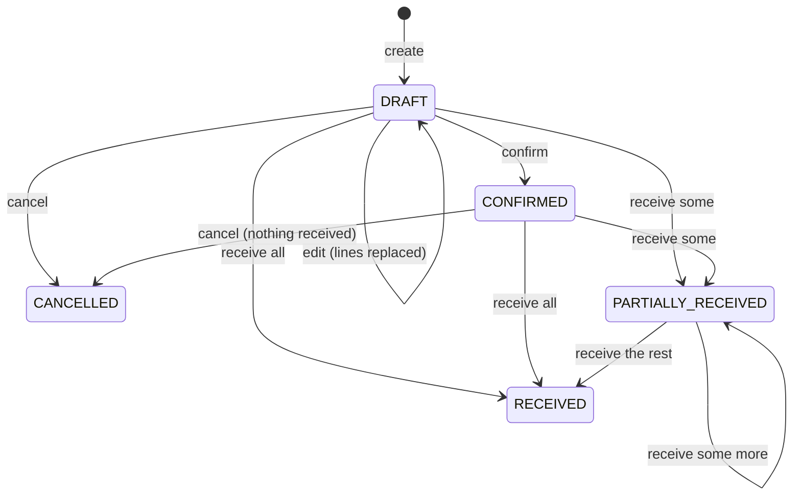

# Procurement Workflow (suppliers, purchases, returns, payments)

As built in Phase 8 (2026-11-19). Code: `apps/api/src/modules/procurement/`.

## In one paragraph

Buying stock from a supplier. A **purchase** is created as a draft, optionally confirmed, and then **received**, in one go or in parts. Only goods that have actually arrived add to stock and add to what the shop owes the supplier. Goods can be **returned** to the supplier. Money paid to a supplier is a **payment**, matched to the purchases it settles (any extra stays as an advance). Every change to what is owed is one line in the **supplier ledger**.

## The life of a purchase

- `receiveNow: true` on create does "create + receive everything" in one transaction (the common walk-in case).
- Once any goods are received the purchase can no longer be cancelled; send goods back with a **purchase return** instead.
- A purchase with received goods is never deleted (database rule).

## What one receipt does (all in ONE database transaction)

1. Locks the purchase.
2. For each line received: the **inventory engine** adds stock at the line's landed cost (see below); the line records how much arrived.
3. Posts the payable for what arrived to the supplier ledger: `payable of line x (received / ordered)`, rounded to the paisa so that all partial receipts add up to **exactly** the line's payable.
4. When the last item arrives, the purchase **round-off** is added to what is owed.
5. Writes the audit entry.

If anything fails (for example a milk batch with no expiry date), **nothing** is saved: no stock, no payable, the status is unchanged.

## How a purchase is priced

All figures are worked out on the server; totals sent by the app are never trusted.

| Step                | Rule                                                                                                      |
| ------------------- | --------------------------------------------------------------------------------------------------------- |
| Line amount         | `quantity (purchase unit) x unit cost`, rounded half-up to paise                                          |
| Discount            | Rupees off the line, never more than the line                                                             |
| Tax                 | `(line - discount) x rate`, added on top                                                                  |
| Freight and similar | `additionalCosts` shared across the lines in proportion to their value (largest remainder, to the paisa)  |
| Payable of a line   | `line - discount + tax + its share of freight`                                                            |
| Total               | Sum of payables + round-off (between -5 and +5)                                                           |
| **Stock cost**      | `(line - discount + freight share [+ tax if the shop is not GST-registered]) / base quantity`, 4 decimals |

Example: 5 bags (25 kg each) at 1400 -> 125 kg at **56.00 per kg**; payable 7000.00.

Input tax credit: a GST-registered shop claims purchase GST back, so it is **not** part of stock cost; a shop that is not registered pays it as a real cost. This rule needs the accountant's confirmation before production (see RISKS_AND_ASSUMPTIONS).

## Purchase returns

Goods go out through the same inventory engine (type `PURCHASE_RETURN`), and the supplier credit is posted to the ledger in the same transaction.

- Credit = the price paid for those goods, in proportion to the purchase line (so partial returns add up exactly to the line's value). It is not the current average cost.
- Only received goods can be returned, and no more than was received minus what was already returned.
- Goods that were already sold cannot be returned: the stock engine refuses (`INSUFFICIENT_STOCK`) and nothing changes.
- Products tracked by batch or expiry must name the batch.
- **Round-off:** the supplier's bill carries its round-off (up to 5 rupees either way) from the moment the last goods arrive. The return that gives the LAST goods back credits it too (shown as `roundOffAdjustment` on the return), so returning a whole purchase always ends with exactly what was billed credited: nothing left owed, never more credited than billed.

## Supplier payments

- `POST /suppliers/:id/payments` with an amount, method (cash, UPI, card, bank transfer, other) and optional reference.
- Leave out `allocations` to settle the **oldest unpaid purchases first**, or choose which purchases to pay. Whatever is not matched stays as an **advance** (the supplier balance goes negative) and is used by later purchases.
- Writes in one transaction: payment (with a `PV/<year>/<number>` voucher number), allocations, a cashbook line on the branch's cash register (the one created with the branch, "Main Register"), and the ledger line.
- A mistake is undone by **reversing** the payment: an opposite payment, cashbook line and ledger line. The original is marked reversed. Nothing is deleted or edited. A payment can be reversed only from the branch it was made in (`X-Branch-Id` required).

## The supplier ledger

`supplier_ledger_entries` is append-only (database trigger). Each row carries a signed amount and the running balance. Positive = the shop owes the supplier.

| Type                    | When                                         | Sign |
| ----------------------- | -------------------------------------------- | ---- |
| `OPENING_BALANCE`       | Supplier created with a balance already owed | +    |
| `PURCHASE`              | Goods received                               | +    |
| `PURCHASE_RETURN`       | Goods sent back                              | -    |
| `PAYMENT`               | Paid the supplier                            | -    |
| `CANCELLATION_REVERSAL` | A payment was reversed                       | +    |

`suppliers.balance` is a cache of the ledger sum, always written together with the ledger line.

## Numbers

`PUR/2026-27/000001` (purchases), `PRT/...` (returns), `PV/...` (payment vouchers). Per branch, per financial year (1 April to 31 March, India time). Gap-free: the counter is increased inside the same transaction, so a failed request never wastes a number, and two simultaneous requests can never get the same one.

## Concurrency and lock order

Every money or stock change takes row locks in the **same order**, so simultaneous requests wait their turn instead of deadlocking:

`purchase` -> `stock balances and batches (inventory engine)` -> `supplier` (last)

Payments take only the supplier lock. Locks are `FOR NO KEY UPDATE`, so recording a payment against a purchase never blocks on a receipt of the same purchase (a plain `FOR UPDATE` would let the two deadlock through the foreign-key check).

## Proof that the books agree

`GET /procurement/reconciliation` returns empty lists when everything agrees:

1. each supplier's balance equals the sum of its ledger lines;
2. each purchase's billed total equals its lines' billed amounts (+ round-off once fully received);
3. ...and equals the ledger lines posted for it;
4. returned totals agree between purchase, lines and return documents;
5. each return's credit is in the ledger;
6. payments table and ledger payment lines agree;
7. stock received per purchase line equals the line's received quantity;
8. stock sent back per line equals its returned quantity.

The integration tests run this after every scenario.

## Database rules (in addition to the application's checks)

- A line can never show more received than ordered, or more returned than received, or a refund larger than what was billed.
- Purchases, returns, payments, allocations and suppliers cannot be deleted. Lines of a purchase that is no longer a draft cannot be deleted.
- Supplier names are unique within a shop, ignoring capital letters.

## API

| Route                                        | Permission             | Notes                                                                   |
| -------------------------------------------- | ---------------------- | ----------------------------------------------------------------------- |
| `GET/POST /suppliers`                        | `supplier.read/manage` | Opening balance needs `X-Branch-Id`                                     |
| `GET/PATCH /suppliers/:id`                   | `supplier.read/manage` | `version` protects against two devices overwriting each other           |
| `POST /suppliers/:id/deactivate\|reactivate` | `supplier.manage`      | Inactive suppliers cannot receive new purchases                         |
| `GET /suppliers/:id/ledger`                  | `supplier.read`        | Statement with running balance                                          |
| `POST /suppliers/:id/payments`               | `supplier.payment`     | `Idempotency-Key` + `X-Branch-Id` required                              |
| `GET /supplier-payments`                     | `supplier.read`        |                                                                         |
| `POST /supplier-payments/:id/reverse`        | `supplier.payment`     | `Idempotency-Key` and `X-Branch-Id` (the payment's own branch) required |
| `GET/POST /purchases`                        | `purchase.read/create` | `X-Branch-Id`; create needs `Idempotency-Key`                           |
| `GET /purchases/:id`                         | `purchase.read`        | Items, received, payments, outstanding                                  |
| `PATCH /purchases/:id`                       | `purchase.create`      | Drafts only                                                             |
| `POST /purchases/:id/confirm\|receive`       | `purchase.create`      | Receive needs `Idempotency-Key`                                         |
| `POST /purchases/:id/cancel`                 | `purchase.cancel`      | Only while nothing was received                                         |
| `GET/POST /purchase-returns`                 | `purchase.read/cancel` | Create needs `Idempotency-Key`                                          |
| `GET /procurement/reconciliation`            | `supplier.read`        |                                                                         |

## Not in this phase

- Mobile screens for purchases and suppliers (the full UI phase builds them).
- Returns that are not tied to a purchase (every return is against a purchase).
- Purchase orders sent to the supplier (the "confirmed" status is the shop's own record).
- GST input-credit reporting (needs the GST phase and an accountant's review).
- Supplier-wise aged payables (Phase 14 reports).
