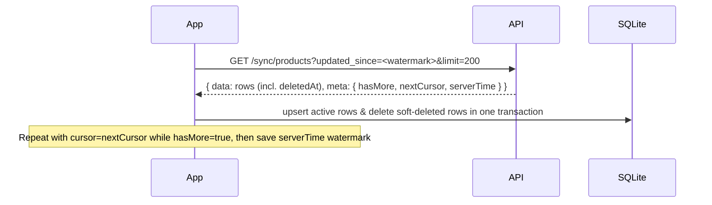
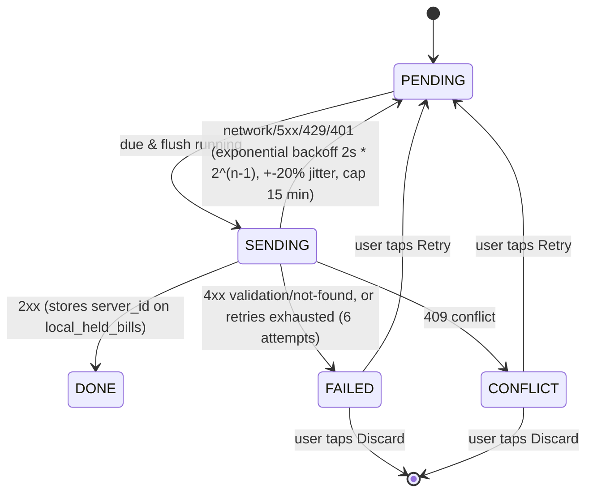

# Data Synchronization Architecture

Phase 14 · Implemented (conservative, online-first per TD-02).

## What lives where

| Data                                                             | Local SQLite (`ksms_cache_v1.db` via `expo-sqlite`)      | Server (PostgreSQL)                       |
| ---------------------------------------------------------------- | -------------------------------------------------------- | ----------------------------------------- |
| Products (with conversions, prices, barcodes), categories, units | Read cache, refreshed by `updated_since` delta pull      | Authoritative                             |
| Customers (lookup, balances, credit limits)                      | Read cache, refreshed by `updated_since` delta pull      | Authoritative                             |
| Draft bills (`draft_bills`, keyed by `org:user:branch`)          | Local only (persists across restarts / disconnects)      | —                                         |
| Held bills (`local_held_bills`)                                  | Local copy until uploaded (`PENDING` → `SYNCED`)         | Authoritative copy (`POST /held-bills`)   |
| Completed sales, collections, stock adjustments, new customers   | **Never created locally (TD-02)**                        | Authoritative (online round trip only)    |
| Outbox (`sync_outbox`)                                           | Pending/failed `HELD_BILL_UPLOAD` operations only        | `idempotency_records` (`Idempotency-Key`) |
| Cache ownership & cursors (`sync_meta`)                          | Local only (`owner_key`, `since:<feed>`, `last_sync_at`) | —                                         |

### Tenant & account isolation on the phone

Every table in `ksms_cache_v1.db` is cleared automatically (`clearAllCache`) in two places:

1. **On logout** (`AuthProvider.signOut()` and whenever auth transitions to `signedOut`, including revoked/expired sessions).
2. **On user or shop switch** (`ensureCacheOwner(db, "${orgId}:${userId}")` on sign-in / session restore wipes all cached rows, drafts, held bills and outbox entries if a different user or shop signs in on the same phone).

## Pull (server change feeds → SQLite read cache)

Server module: `apps/api/src/modules/sync/` (`SyncModule`, read-only, layer L0, zero module dependencies).

| Endpoint               | Permission      | Scope             | Cursor & ordering            | Soft deletes           |
| ---------------------- | --------------- | ----------------- | ---------------------------- | ---------------------- |
| `GET /sync/products`   | `product.read`  | `organization_id` | Composite `(updated_at, id)` | Included (`deletedAt`) |
| `GET /sync/categories` | `product.read`  | `organization_id` | Composite `(updated_at, id)` | Included (`deletedAt`) |
| `GET /sync/units`      | `product.read`  | Global reference  | Stable `id`                  | N/A                    |
| `GET /sync/customers`  | `customer.read` | `organization_id` | Composite `(updated_at, id)` | Included (`deletedAt`) |

Every endpoint returns `{ data: [...], meta: { limit, hasMore, nextCursor, serverTime } }`:

- `updated_since` (ISO-8601 with timezone) filters `updated_at >= updated_since` (inclusive so same-millisecond writes are never missed).
- `cursor` is an opaque base64url JSON keyset token encoding `(updated_at, id)` (or `id` for units), guaranteeing zero skips and zero duplicates even when many rows share the exact same `updated_at`.
- `limit` defaults to `200` (max `500`).
- Every price, conversion, or barcode edit calls `ProductsService.finishChange()`, which bumps `products.version` and `updated_at`, so product delta pulls always pick up child changes.
- On the phone (`apps/mobile/src/sync/sync-engine.ts`), each page is applied in one SQLite transaction: active rows are upserted (`INSERT OR REPLACE`), and rows with `deletedAt !== null` are removed (`DELETE`, including their cached barcodes). When `hasMore === false`, page 1's `meta.serverTime` is saved as `since:<feed>`.

## Push (outbox — held bills only)

In Phase 14 the outbox (`sync_outbox`) has **one job only**: uploading held bills (`operation_type = 'HELD_BILL_UPLOAD'`) via `POST /held-bills` with `Idempotency-Key = operation_id` (UUID) and `X-Branch-Id = branch_id`.

- `POST /held-bills` runs inside `IdempotencyService.execute` whenever `Idempotency-Key` is provided, returning `Idempotent-Replayed: true` and the original held-bill ID on retries — guaranteeing **zero duplicate held bills** even across app crashes or dropped responses.
- Any row left in `SENDING` after a crash is recovered to `PENDING` on the next flush and retried safely with the same `Idempotency-Key`.

**Out of scope by design (TD-02):** offline completed sales, offline collections, offline stock adjustments, and offline customer creation are **not** queued. Checkout (`Pay`) requires a live server round trip; if offline, the bill stays safely persisted as a local draft or held bill.

## UI & triggers

- **Status indicator (`SyncBanner`)**: shown on Home and Billing; displays synced time, syncing progress, offline mode, pending held-bill count, or failed-upload warning. Tapping opens `/sync`.
- **Sync & failed items screen (`apps/mobile/app/sync.tsx`)**: shows connection/sync status, last synced time, local cache counts (products, categories, units, customers), manual **Sync now**, waiting queue with next retry time, and failed/conflicted items with **Retry** and **Discard**.
- **Triggers**: automatic sync on sign-in, when returning to the foreground (`AppState` `'active'`), periodic 20-second retry polling while pending outbox items exist, and manual pull-to-refresh / **Sync now**.
- **Offline fallbacks**: product search (`sale/add-item`), barcode scan (`sale/scan`), customer picker (`sale/customer`), khata list (`(tabs)/khata`), and held bills (`held-bills`) fall back to SQLite when a network failure occurs, displaying an offline banner.
