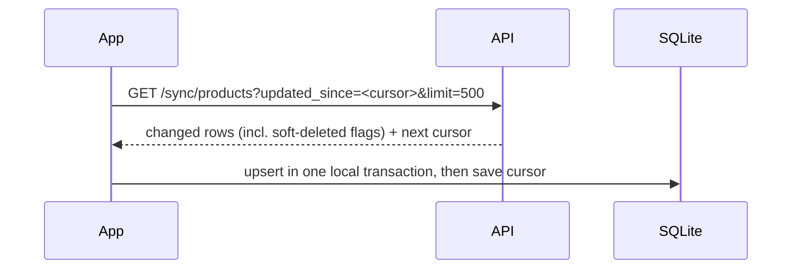
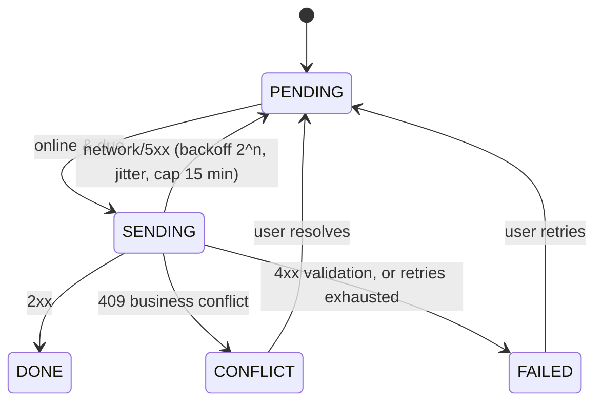

# Data Synchronization Architecture

Phase 1 · draft. Conservative, online-first (TD-02).

## What lives where

| Data                                                       | Local SQLite                        | Server                                |
| ---------------------------------------------------------- | ----------------------------------- | ------------------------------------- |
| Products, categories, prices, barcodes, customers (lookup) | Read cache, refreshed by delta pull | Authoritative                         |
| Draft carts / held bills                                   | Authoritative until submitted       | Optional copy for cross-device pickup |
| Completed sales, payments, ledgers, stock                  | **Never created locally**           | Authoritative                         |
| Preferences, device id                                     | Local only                          | —                                     |
| Outbox                                                     | Pending retriable operations        | Idempotency + `sync_operations`       |

## Pull (cache refresh)

Cursor is a server `(updated_at, id)` pair. Stock quantities shown offline are marked "as of <time>" and are not used to authorize a sale.

## Push (outbox)

Outbox row: `operation_id (UUID, = Idempotency-Key)`, `device_id`, `operation_type`, `entity_id`, `local_created_at`, `payload_version`, `payload`, `sync_status` (PENDING, SENDING, DONE, FAILED, CONFLICT), `retry_count`, `next_retry_at`, `last_error`; server stamps `server_received_at`.

Initial outbox users: non-financial writes only (e.g., customer create/edit, product notes, held-bill upload). **Checkout requires a live server round trip**; if offline, the cart stays a draft and the UI says so. The same idempotent command shape is reused so controlled offline billing can be added later with explicit stock allocation per device.

## Conflicts

No last-write-wins for financial data. Master-data edits use `version` (optimistic concurrency); stale writes return 409 and the user chooses. Duplicate operation ids return the original result.

## UI

Sync status chip (online/offline/syncing), last successful sync, failed-operations list with retry/discard, network-recovery trigger (NetInfo) and foreground trigger.
