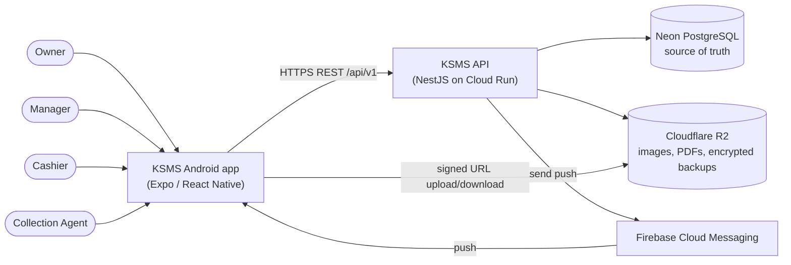
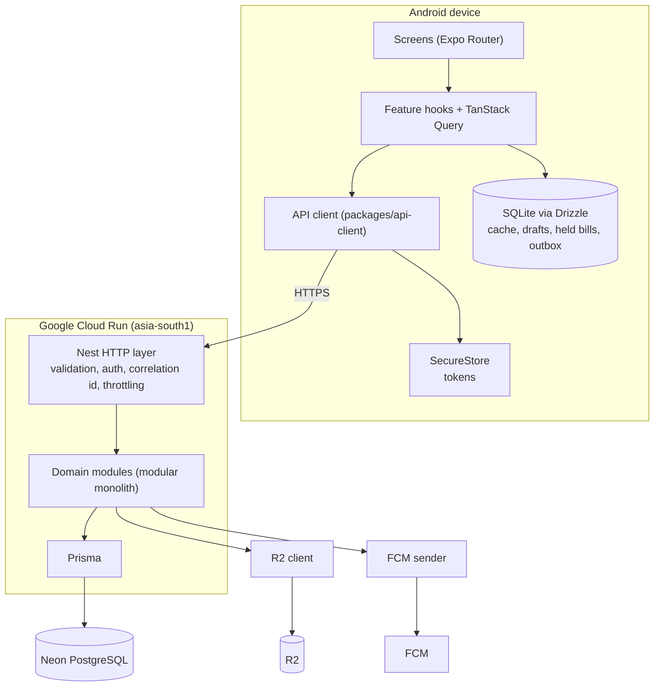
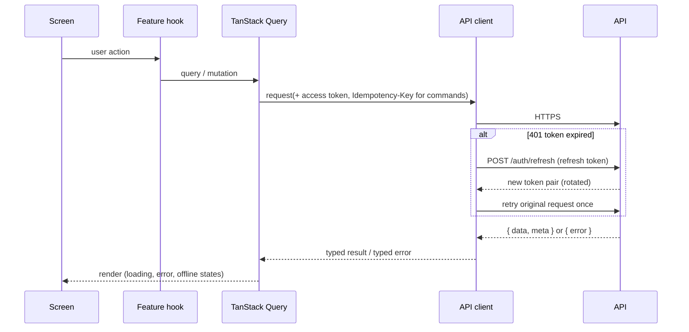
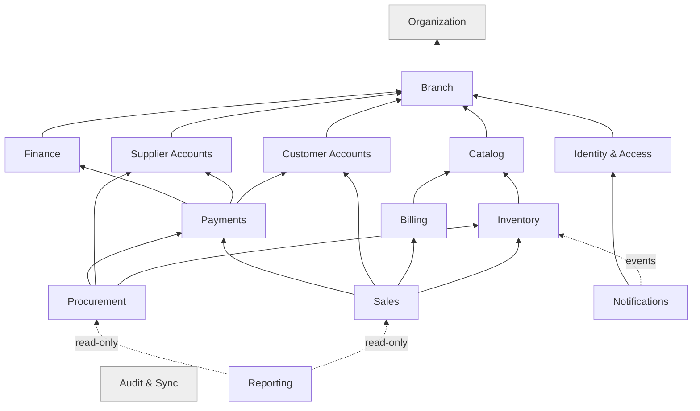

# System Context and High-Level Architecture

Phase 1 · Status: draft for approval · Supersedes the outline in `../ARCHITECTURE.md` where they differ.

## 1. System context (C4 level 1)

Only the API talks to PostgreSQL. The app never connects to the database, R2 credentials or FCM server keys.

## 2. High-level architecture (containers)

## 3. Mobile-to-backend communication

Rules: no API calls inside components; money fields travel as **decimal strings**; every command carries an `Idempotency-Key` UUID generated when the user starts the action (reused on retry).

## 4. Backend module dependency rules

A module may import only the **public service interface** of modules in a lower layer. Same-layer and upward imports are forbidden. Cross-cutting reactions use post-commit domain events.

| Layer | Modules                                                                 | May depend on                                                                                                                |
| ----- | ----------------------------------------------------------------------- | ---------------------------------------------------------------------------------------------------------------------------- |
| L0    | Audit & Sync, Organization                                              | nothing (everyone may call Audit)                                                                                            |
| L1    | Branch, Identity & Access                                               | L0                                                                                                                           |
| L2    | Product Catalog, Customer Accounts, Supplier Accounts, Finance, Billing | L0–L1                                                                                                                        |
| L3    | Inventory, Payments                                                     | L0–L2 (Inventory→Catalog; Payments→Customer/Supplier Accounts, Finance)                                                      |
| L4    | Procurement, Sales                                                      | L0–L3                                                                                                                        |
| L5    | Reporting, Notifications                                                | Reporting: read-only queries over any table, owns no writes. Notifications: subscribes to events, calls Identity for devices |

(All modules also call Audit; edges omitted for readability. **Enforced** by `apps/api/src/architecture.spec.ts`, which runs in `pnpm check` and CI: it reads the real imports and fails on any import a module is not allowed to make, on `common/` importing from feature modules, and on cycles. When a module is added or starts using another, update the map in that test and this diagram.)

### Responsibilities

| Module                | Owns                                                                                                                          |
| --------------------- | ----------------------------------------------------------------------------------------------------------------------------- |
| Organization / Branch | Org, branch, shop & GST settings, cash registers' branch link                                                                 |
| Identity & Access     | Users, sessions, devices, roles, permissions, invitations, auth guards                                                        |
| Product Catalog       | Categories, products, units, conversions, unit prices, barcodes, tax config per product                                       |
| Inventory             | Balances, movements, batches, adjustments, valuation, low-stock/expiry queries                                                |
| Customer Accounts     | Customers, customer ledger entries, balances, credit limit                                                                    |
| Supplier Accounts     | Suppliers, supplier ledger entries, balances                                                                                  |
| Finance               | Expenses, cash registers, cashbook, daily closing                                                                             |
| Payments              | Payment records, allocation to documents, receipts, duplicate protection; writes ledger + cashbook through the owning modules |
| Billing               | Tax engine, rounding, invoice numbering, invoice snapshot, PDF                                                                |
| Procurement           | Purchases, receipts, purchase returns                                                                                         |
| Sales                 | Checkout orchestration, held bills, cancellations, returns, collections orchestration                                         |
| Reporting             | Aggregations only                                                                                                             |
| Notifications         | FCM, notification records                                                                                                     |
| Audit & Sync          | Audit log, idempotency records, sync operations                                                                               |

Collection agents/records live in Customer Accounts (records) with assignments referencing Identity users.

## 5. Complexity review

Reviewed and **kept out**: Redis, queues, CQRS/event sourcing, separate read DB, microservices. Reporting runs SQL aggregates on the primary (shop-scale volume). PDF generation runs in-process after commit. Idempotency and invoice sequences live in Postgres. Everything else in the spec is retained.
