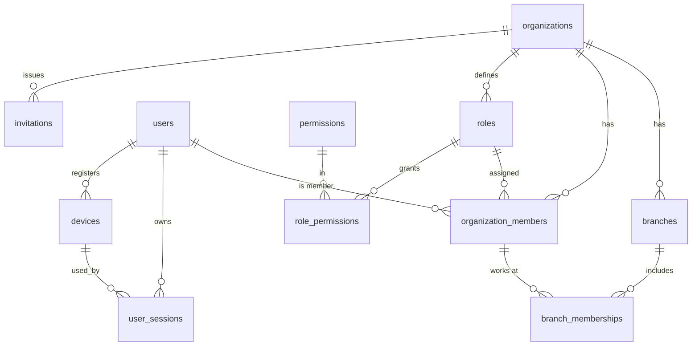
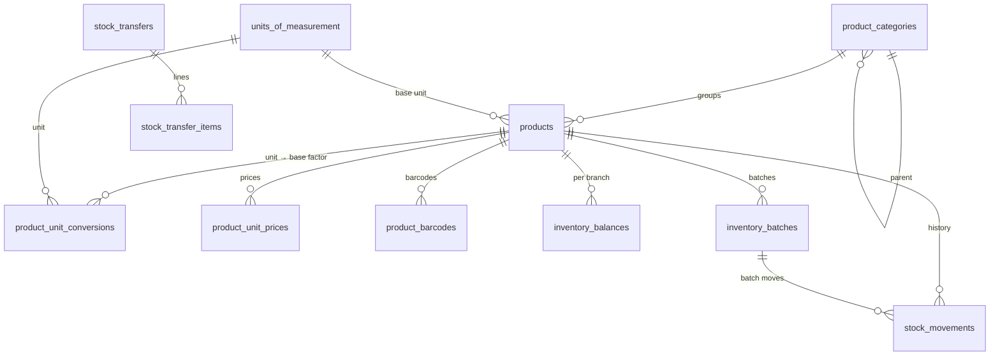
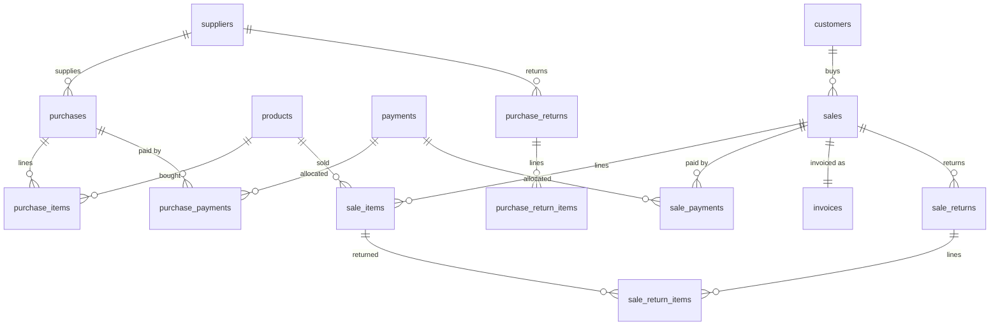
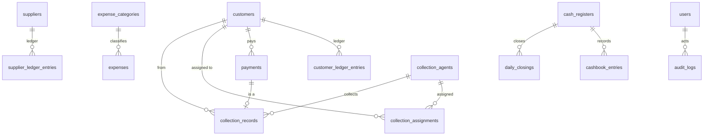

# Entity Relationship Diagrams

Phase 2 · source of truth is `apps/api/prisma/schema/*.prisma`. Diagrams show key columns and relationships only (53 tables total). Actor columns (`created_by_id`, `cancelled_by_id`, …) are plain UUIDs unless shown as a relationship.

## 1. Identity and organization

## 2. Catalog and inventory

`stock_adjustments` links to its `stock_movements` row through `movement_id` (unique).

## 3. Procurement and sales

## 4. Finance and operations

Standalone tables (no FKs, keyed by org): `held_bills`, `document_sequences`, `notifications`, `idempotency_records`, `sync_operations`.

## 5. Source-of-truth vs derived data

| Derived cache                         | Source of truth                        | Reconciliation             |
| ------------------------------------- | -------------------------------------- | -------------------------- |
| `inventory_balances.quantity_on_hand` | SUM(`stock_movements.quantity`)        | Phase 7 test + nightly job |
| `inventory_batches.quantity_on_hand`  | SUM(batch movements)                   | Phase 7                    |
| `customers.balance`                   | SUM(`customer_ledger_entries.amount`)  | Phase 11                   |
| `suppliers.balance`                   | SUM(`supplier_ledger_entries.amount`)  | Phase 12                   |
| `sale_items.returned_base_quantity`   | SUM(`sale_return_items.base_quantity`) | Phase 9                    |
| Cash expected (daily closing)         | opening + SUM(CASH `cashbook_entries`) | Phase 12                   |
